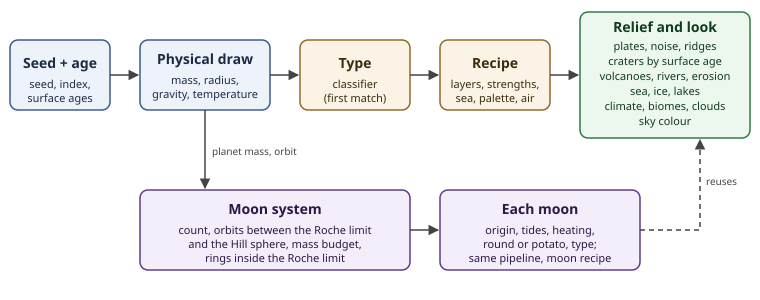

# L10 generation — making planets and moons automatically

This subtopic explains how to **generate** planets and moons from a seed
and an age: how a world's type is chosen, how its relief, climate and
landforms are built, how its moons are chosen and evolve, and how all of it
changes over a world's lifetime, so that every type comes out of the
generator on its own. It is the "how to make one" companion to the
descriptive pages of [L10 — Planets and moons](../../documents/README.md)
and to the [planet and moon kinds catalog](../../../catalogs/documents/planets.md),
which say what real worlds look like.

## Scope

- In scope: the generation pipeline from seed and age to finished world;
  type classification; height maps on a sphere and deeper terrain
  techniques; plates, rifts and mountains; volcanoes, rivers, deltas, karst
  and lakes; climate, biomes, clouds and sky colour; moon systems, moon
  types and moon dynamics; how all of it changes with age; checks.
- Out of scope: drawing and shading (see `docs/` and the renderer), star
  and system layout above the planet (see
  [L09 — Stars](../../../L09/documents/README.md)), and the frozen scale
  ladder (`docs/universes/ladder.md`).

## Documents

Foundations:
- [Height maps](./height-maps.md) — the relief toolbox: sampling noise on
  a sphere, fBm, ridged and hybrid multifractals, domain warping, masks,
  craters, volcanoes, erosion, sea level, and how gravity limits relief.
- [Terrain techniques](./terrain-techniques.md) — deeper methods:
  derivative and cellular noise, rivers-first networks, stream-power and
  simulated erosion, glacial valleys, fractal coastlines.

Planets:
- [Planet types](./planet-types.md) — the classifier (mass, radius,
  temperature, ice line) and one recipe per planet type, from iron worlds
  to gas giants.
- [Plates](./plates.md) — how plates move, how rifts and mountains form,
  and how to generate plates, boundaries and their relief.
- [Landforms](./landforms.md) — volcano types and profiles, river
  networks and meanders, deltas (Nienhuis ratios), karst, crater rays and
  secondaries, dunes, moraines and eskers, supervolcanoes.
- [Lakes](./lakes.md) — how lake basins form, lakes on other worlds, and
  how to fill basins from a liquid budget.
- [Air model](./air-model.md) — keeping air (cosmic shoreline over
  age), gas mix, pressure band and greenhouse per type.
- [Climate and look](./climate-and-look.md) — temperature, rain belts,
  biomes, plant colour under other stars, clouds, sky colour.

Moons:
- [Moons](./moons.md) — moon systems (count, orbits, mass budget, rings)
  and one recipe per moon type, including irregular "potato" moons.
- [Moon dynamics](./moon-dynamics.md) — how moons form, tidal heating,
  resonances, decay and drift, co-orbital moons, rings that fade.

Time:
- [Lifetime](./lifetime.md) — age as an input: the brightening star,
  craters piling up and softening, cooling interiors, air kept or lost,
  tidal locking and moon recession, erosion over time.

Records:
- [Sources](./sources.md) — external references `GEN-S001` to `GEN-S031`,
  and [research-pass sources](./sources-passes.md) — `GEN-S032` to
  `GEN-S076`.

## The pipeline at a glance

1. **Seed and age.** Every world gets its own random stream from the
   system seed and its index, and the system's age; regions get surface
   ages from resurfacing events ([lifetime](./lifetime.md)).
2. **Physical draw.** Mass, orbit distance and the star (its brightness at
   that age) give radius, surface gravity and equilibrium temperature.
3. **Type.** A classifier turns those numbers into one planet type
   ([planet types](./planet-types.md#the-classifier)).
4. **Recipe.** The type picks a recipe: which layers, their strengths, sea
   level, palette, air.
5. **Relief.** Plates, noise layers, craters (by surface age), volcanoes
   and rivers are summed into one height function of the surface direction
   ([height maps](./height-maps.md), [plates](./plates.md),
   [landforms](./landforms.md)); basins fill with lakes
   ([lakes](./lakes.md)).
6. **Climate and look.** Temperature and rain give biomes, clouds and sky
   colour ([climate and look](./climate-and-look.md)).
7. **Moons.** Origins, orbits between the Roche limit and the Hill sphere,
   tides and rings at the system's age; each moon runs the same pipeline
   with a moon recipe ([moons](./moons.md),
   [moon dynamics](./moon-dynamics.md)).

## Options to decide

Every page ends its generation rules with recommendations; none is a
decision. The main choices, from cheapest to most work:

| Option | Gives | Cost | Pure function of direction, seed and age? | Page |
|---|---|---|---|---|
| 3D noise relief (fBm, ridges, warp) with a gravity scale | believable hills and ranges on every rocky world | low | yes | [height maps](./height-maps.md) |
| Type classifier from mass, radius, temperature | every planet type appears on its own | low | yes | [planet types](./planet-types.md) |
| Craters by surface age, softened by age | believable airless moons and old highlands | low-moderate | yes | [height maps](./height-maps.md#building-block-6-craters), [lifetime](./lifetime.md) |
| Moon origins, limits, types, heating score | consistent moon systems | low-moderate | yes | [moons](./moons.md), [moon dynamics](./moon-dynamics.md) |
| Climate bands and biomes | coloured, varied Earth-like worlds | moderate | yes | [climate and look](./climate-and-look.md) |
| Voronoi plates with boundary relief | real-looking ranges, rifts, trenches | moderate | yes | [plates](./plates.md) |
| Volcano and delta stamps, pure lakes | recognisable landforms | moderate | yes | [landforms](./landforms.md), [lakes](./lakes.md) |
| Rivers-first networks per region | rivers that flow to the sea | high | yes, per region | [terrain techniques](./terrain-techniques.md#rivers-first) |
| Age as an input (whole lifetime) | the same world at any age | moderate, touches all layers | yes | [lifetime](./lifetime.md) |
| Baked erosion and baked lakes | the most natural terrain | high | no: deterministic bake per tile | [terrain techniques](./terrain-techniques.md#simulated-erosion), [lakes](./lakes.md#finding-lakes-in-a-height-map) |

## How Astrolith does it today

As read from `crates/universe-core/src/terrain.rs` on 2026-10-14:
- the planet surface is the icosphere split once (80 flat faces) with **no
  relief** since #593;
- the body recipe picks air from radius (airless under 0.5 Earth radii,
  giant from 3 Earth radii);
- the moon count is 0-2 for rocky planets (under 2 Earth radii) and a draw
  up to 28 or 274 for giants;
- `noise.rs` holds a deterministic, periodic value noise shared with L1-L3;
- since #626 a planet-squares shader can draw the surface, tuned live in
  the engine lab since #665.

## Related

- Parent topic: [L10 — Planets and moons](../../documents/README.md).
- Catalog of kinds: [planet and moon kinds](../../../catalogs/documents/planets.md),
  [rocks](../../../catalogs/documents/rocks.md).
- Descriptive pages this builds on: [surface](../../documents/surface.md),
  [tectonics](../../documents/tectonics.md),
  [volcanism](../../documents/volcanism.md),
  [impacts](../../documents/impacts.md),
  [hydrosphere](../../documents/hydrosphere.md),
  [moons](../../documents/moons.md),
  [lifetime](../../documents/lifetime.md).
- Below the planet: [L11 — Regions of a planet](../../../L11/documents/README.md).

## Documentation status

2026-10-14: first version plus five research passes (lifetime, terrain
techniques, climate and look, moon dynamics, landforms and a consistency
review), then pass A (full-text sources, tuned values, star classes) and pass B
(air model, energy-balance climate, plate trigger) and pass C (binary
moons, ring model, origin rates, more landforms, the delta ratios).
13 pages, 76 sources, one SVG diagram. The sources behind the formulas
were read in full; most others as abstracts or summaries, and each entry
in [sources](./sources.md) says so.
Proposed next: worked parameter tables tuned against real Solar System
relief (Moon, Mars, Earth hypsometry), once the game chooses which options
to take.
